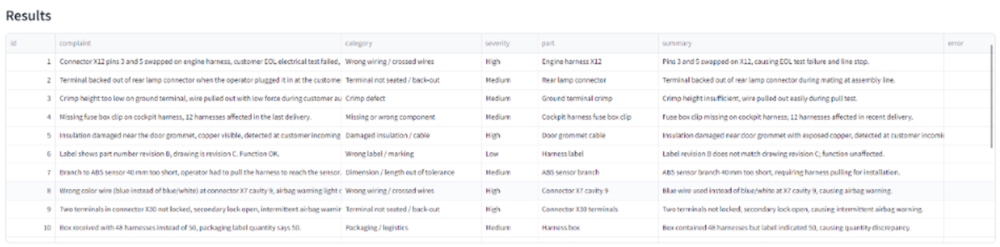

# 8D Copilot – Generative AI assistant for automotive customer complaints

**Author:** Feryel Jebali  · Computer Science Engineering  ·  **Type:** individual project  ·  **Stack:** Python, Streamlit, OpenAI SDK (Groq / Gemini / OpenAI), SQLite

## 1. The problem

In a wire-harness plant, the quality department receives customer complaints
every week: swapped pins, terminals backing out, crimp defects, wrong labels.
For each one, an engineer has to classify it, count the trends for management,
find the root cause with 5-Why and Ishikawa, and write an 8D report for the
customer. This takes hours and the quality of the 8D depends on who writes it.

8D Copilot automates the first draft of this whole chain. The engineer stays
in control: the app produces drafts and marks unverified points as hypotheses.

## 2. What the app does (multi-step pipeline)

```
complaints (text / CSV / PDF)
   │
   ├─ Step 1  Classify each complaint     few-shot + persona + JSON      T=0.0
   ├─ Step 2  Pareto (counted in Python)  + management summary (zero-shot) T=0.3
   ├─ Step 3  Root cause                   chain of thought, 5-Why, 6M   T=0.4
   ├─ Step 4  8D report draft              persona + fixed template      T=0.5
   ├─ Step 5  Auditor self-review          iterative refinement          T=0.2
   └─ Step 6  Customer email               persona + tone constraint     T=0.7
   │
   └─ Export: CSV, Markdown 8D, prompt log JSON · History saved in SQLite
```

The output of each step is the input of the next one, so this is real
processing, not one question and one answer.

## 3. Prompt engineering techniques

All prompts are in `core/prompts.py`, each labelled with its technique.

| Technique | Where | Why |
|---|---|---|
| Zero-shot | Management summary, prompt-lab baseline | Simple task, the Pareto table is already structured |
| Few-shot (5 examples) | Classification | Teaches the exact categories, severity logic and JSON format |
| Chain of Thought | Root cause | Forces facts → 6M → 5-Why → non-detection → verification, in order |
| Persona / role | Senior quality engineer, quality manager, VDA 6.3 auditor | Sets vocabulary, level of detail and tone |
| Structured output | JSON schemas, fixed 8D headings, tables | Output can be parsed, shown in tables and exported |
| Iterative refinement | Step 5: a "strict auditor" reviews and rewrites the 8D | The model checks its own draft against IATF criteria |

Every prompt follows the **3C principle**:
- **Clarity:** the exact task (e.g. "category must be exactly one of …").
- **Context:** the role and the plant situation (IATF 16949 wire-harness supplier).
- **Constraints:** length limits, allowed values, JSON only, "never invent names or numbers".

## 4. Parameter tuning

Each step has its own parameters (`core/pipeline.py`, `STEP_PARAMS`):

| Step | temperature | max_tokens | top_p | Reason |
|---|---|---|---|---|
| Classify | 0.0 | 1500 | 1.0 | Same complaint must always get the same category |
| Trend summary | 0.3 | 2000 | 0.9 | Factual, a little freedom in wording |
| Root cause | 0.4 | 4000 | 0.9 | Needs some creativity to propose hypotheses |
| 8D draft | 0.5 | 6000 | 0.9 | Long structured text |
| Self-review | 0.2 | 7000 | 0.9 | Critical checking, not creativity |
| Customer email | 0.7 | 2000 | 0.95 | Natural, human wording |

**Lesson learned during testing:** the first version used small budgets
(200 tokens for classification). With Gemini 3.8 Flash, a "thinking" model,
every classification failed: the hidden reasoning tokens count against
`max_tokens`, so the JSON was cut off before it was complete. The fix had
two parts: larger `max_tokens` budgets, and `reasoning_effort = "low"` for
Gemini so the model thinks less on simple steps. The app now also detects
when an answer was cut off (`finish_reason = "length"`) and tells the user
to raise `max_tokens`, instead of showing a generic JSON error.

In the sidebar the user can switch "Override the per-step defaults" on and
use their own temperature, max_tokens and top_p for every step.

## 5. Experimentation (Prompt lab tab)

The Prompt lab runs the same complaint through three prompt versions and
several temperatures, side by side, and exports the results as CSV.
These three versions are also the history of how the classification prompt
was refined:

1. **Zero-shot:** "Classify this complaint by defect type and severity."
2. **Chain of Thought:** rules + "think step by step", then JSON.
3. **Few-shot + persona + JSON rules:** the version used in the app.

**Results** (real run, Groq `openai/gpt-oss-120b`, test complaint: "Two terminals
in connector X30 were not locked, secondary lock open, intermittent airbag warning"):

| Version | Output format | Category | Stable at T=0.0 vs 1.0? | Tokens |
|---|---|---|---|---|
| Zero-shot | Markdown free text | Invented: "Mechanical locking failure" | No: severity "High / safety-critical", then "S1" | 222–232 |
| Few-shot + persona + JSON | Valid JSON | Allowed: "Terminal not seated / back-out" | Yes: only the summary wording changed | 683–702 |
| Chain of Thought | Steps + JSON at 0.0, JSON only at 1.0 | Allowed (same) | Classification yes, but reasoning skipped at 1.0 | 396–516 |

**Conclusion:** zero-shot was correct in substance but cannot be counted in a
Pareto (free text, invented categories, inconsistent severity). Few-shot gave
stable, parseable JSON with an allowed category, so it is used for Step 1,
at the cost of about 3x more tokens. Chain of Thought added nothing for this
simple task and was not followed consistently at high temperature, so it is
used where reasoning matters: the root-cause analysis.

**Second refinement:** in a test run the management summary miscounted
("7 of 9 High" instead of 6) although the correct table was in the prompt.
The prompt now says "only quote numbers that appear in the table, do not add
or recalculate them". This confirms the choice to compute statistics in Python.



## 6. Error handling

| Problem | What the app does |
|---|---|
| Empty or too-short input | Warning, button stays disabled |
| Too many complaints / very long text | Limited to 50 complaints, 2000 characters each |
| Unreadable CSV/PDF, scanned PDF | Clear message explaining why |
| Missing or wrong API key | Stops at once with a message |
| Wrong model name / no access | Stops at once, tells the user to check the model |
| Rate limit (429) | Waits 20 s, then 40 s, and retries (free tiers reset per minute) |
| Timeout, connection error, server error | Retries 3 times, then a clear message |
| Invalid JSON from the model | Removes ``` fences, extracts the JSON; if still invalid, asks the model once to repair it |
| Category outside the allowed list | Replaced by "Other" in code (validation) |
| One complaint fails in a batch | That row gets an error message, the others continue |
| Empty model answer | Message suggesting to raise max_tokens |
| Answer cut off by max_tokens | Detected with `finish_reason`, clear message instead of a JSON error |
| Model does not accept `reasoning_effort` | Retried automatically without it |

## 7. Design decisions

- **Numbers are counted in Python, not by the model.** The Pareto is
  computed with pandas, then given to the model to summarise. This avoids
  invented statistics.
- **One client for three providers.** Groq and Gemini both offer an
  OpenAI-compatible endpoint, so the app works with free API keys and the
  provider can be changed in the sidebar without touching the code.
- **Groq as default provider.** During testing, Gemini's free tier hit its
  daily request limit after about 10 complaints (each complaint is one API
  call). Groq's free tier allows far more requests and is much faster, so it
  became the default (model `openai/gpt-oss-120b`). The first Groq model I
  planned to use, `llama-3.3-70b-versatile`, had been retired by Groq, which
  is why the model name is editable in the sidebar.
- **Rate-limit strategy.** Free tiers reset per minute, so the retry waits
  are 20 s and 40 s rather than a few seconds.
- **The model never invents owners or dates.** The 8D prompt requires "TBD"
  and "(hypothesis – to verify)", because an 8D is an official document.
- **Transparency.** The Prompt log tab shows every call: prompt, parameters,
  answer, time and tokens, and can be exported.

## 8. Project structure

```
app.py                  Streamlit interface (5 tabs)
core/llm_client.py      API calls, retries, error handling, JSON parsing
core/prompts.py         all prompts, labelled by technique
core/pipeline.py        the 6 processing steps and their parameters
core/file_loader.py     text / CSV / PDF input and validation
core/storage.py         SQLite history
data/sample_complaints.csv   18 realistic test complaints
8D copilot doc-FeryelJebali-public.pdf.  project documentation (PDF)
```

## 9. How to run

```bash
pip install -r requirements.txt
streamlit run app.py
```

Get a free API key at https://console.groq.com (Groq, recommended) or
https://aistudio.google.com (Gemini), choose the provider in the sidebar,
paste the key, choose "Use sample data" and click **Classify complaints**.

To avoid pasting the key each time, copy `.streamlit/secrets.toml.example`
to `.streamlit/secrets.toml` and put the key there (this file is ignored by Git).

Model names change over time. If the default model is not found, type a
current model name from your provider in the sidebar.
